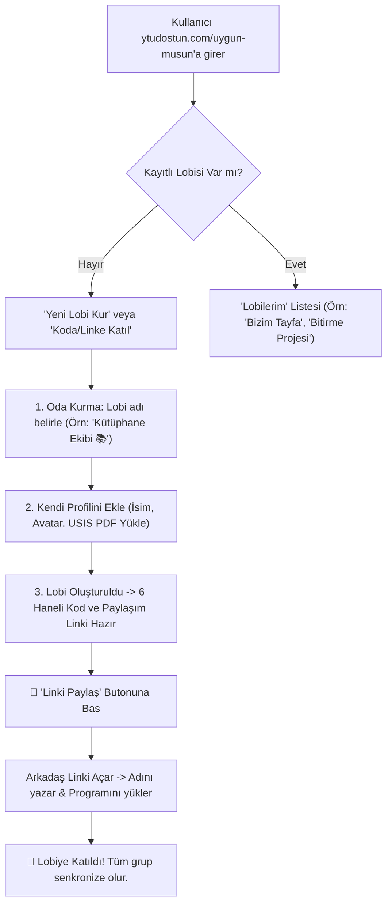

# 📋 YTÜ Dostun: "Uygun Musun?" Çoklu Arkadaş Lobisi & Grup Müsaitlik Özellik Planı (FEATURE_PLAN)

Bu doküman, "Uygun Musun?" özelliğini 2 kişilik özel durumdan; öğrencilerin kendi arkadaş gruplarını (proje takımı, kütüphane ekibi, yemek tayfası vb.) kurup davet linkiyle birbirlerini ekleyebildikleri, herkesin anlık durumunu ve tüm grubun ortak boş vakitlerini görebildikleri bir **Kampüs Sosyal Lobi Platformuna** dönüştürme planıdır.

---

## 🎯 1. Ürün Vizyonu ve Kullanıcı Akışı



### 📱 Temel Ekranlar & Kullanıcı Deneyimi:
1. **Lobi Karşılama Ekranı (`/uygun-musun`):**
   - *"Arkadaşlarınla ne zaman buluşabileceğini tek tıkla gör!"*
   - **Aksiyonlar:** `[ ➕ Yeni Grup Lobisi Kur ]` ve `[ 🔗 Koda Sahip misin? Katıl ]`
   - **Kayıtlı Lobilerim:** Tarayıcı hafızasındaki (LocalStorage) odalar listelenir; kullanıcı tek dokunuşla önceki lobilerine dönebilir.

2. **Lobi Kurulum Sihirbazı (30 Saniye):**
   - **Lobi Adı:** Örn. *"Yemekçiler 🍕"*, *"EEF Bitirme Grubu"*, *"Hazırlık C1"*
   - **Kurucu Profili:** Ad, avatar seçimi ve ders programı (USIS PDF yükleme veya hızlı el ile ders seçimi).
   - **Yönetici Jetonu (Admin Token):** Kurucunun LocalStorage'ında saklanan gizli anahtar (üyeleri yönetme / lobi adını değiştirme yetkisi).

3. **📲 Gelişmiş Davet & Paylaşım Mekanizması:**
   - **Tek Dokunuşla "Paylaş" Butonu (`navigator.share`):**
     - Mobilde tıklandığında doğrudan telefonun yerel paylaşım sayfasını (WhatsApp, Instagram DM, Telegram, AirDrop, Mesajlar) açar.
     - Paylaşılan hazır davet metni:  
       `"👋 YTÜ Dostun'da 'Kütüphane Ekibi 📚' lobisi kurdum! Programını ekle, ne zaman boş olduğumuzu canlı görelim: https://ytudostun.com/uygun-musun?join=KUTUP5"`
   - **Masaüstü / Pano Kopyalama (Clipboard):** Masaüstünde veya paylaşım sayfası desteklenmeyen tarayıcılarda linki anında panoya kopyalar ve *"Bağlantı kopyalandı! Arkadaşlarına gönderebilirsin 📋"* toast bildirimi gösterir.
   - **Masa Başı QR Kod Kartı:** Kütüphanede veya kantinde yan yana otururken arkadaşının kamerayla okutup 5 saniyede katılması için modal içi QR kod.

---

## 👥 2. Çok Kişili (N-Kişi) Arayüz Mimarisi

Çok kişilik lobi arayüzü 4 ana bileşenden oluşur:

### 🧩 1. Grup Nabzı (Group Pulse)
Tüm grubun anlık özetini tek bir dinamik adada sunar:
- **Canlı Dağılım:** `🟢 4 Müsait` • `🔴 2 Derste` • `💻 1 Online Ders`
- **Tam Kadro Ortak Boşluk:**  
  *"🎉 Gruptaki herkesin ortak boş olduğu bir sonraki vakit: **Bugün 15:30 - 17:00 (1.5 saat)**"*
- **Çoğunluk Önerisi:**  
  *"💡 6 kişiden 5'i şu an müsait! (Sadece Ahmet 14:30'a kadar derste)"*

### 📋 2. Üye Durum Izgarası (Member Cards)
Grubun üyeleri 2 sütunlu mobil kartlar halinde listelenir:
- Her kartta:
  - Avatar, İsim ve Canlı Durum Rozeti (Müsait, Derste, Online Ders, Erken Çıktı, Kütüphanede vb.)
  - Dersteyse kalan süre sayacı ve derslik bilgisi.
  - Kart üzerine dokunulduğunda: Kişiyi dürtme veya günün derslerini açma.

### 📊 3. Çoklu Paralel Çizelge (Group Timeline Matrix)
Günün saat dilimleri (08:00 - 19:00) boyunca tüm üyelerin ders blokları alt alta akar:
- **Tüm satırların boş olduğu saat aralıkları parlak altın/yeşil renkle vurgulanır.**
- Böylece grupça kahve içilecek veya ders çalışılacak en uygun saat bir bakışta görülür.

### 📢 4. Gruba Genel Seslen (Broadcast Ping)
Bir üye tek dokunuşla tüm gruba canlı çağrı fırlatabilir:
- `☕ "Orta bahçedeyim, kahveye gelen var mı?"`
- `📚 "Kütüphane 1. kattayız, masa hazır!"`
- `🍕 "Yemekhane / Yemek vakti?"`
Gruptaki tüm üyelere anında in-app ve kilit ekranı (Web Push) bildirimi gider.

---

## 🧮 3. Çoklu Profil Boşluk Hesaplama Motoru (N-Person Overlap)

Mevcut ikili motor, N-kişi için zaman penceresi dilimleme algoritmasına evrilir:

```typescript
// Gruptaki N profil için kesişim algoritması
export function calculateGroupMutualAvailability(
  profiles: UygunMusunProfile[],
  dayName: string,
  currentMinutes: number
): GroupAvailabilitySummary {
  // 1. Günün tüm saatlerini 10'ar dakikalık dilimlere böl (480dk -> 1200dk)
  // 2. Her dilim için grupta müsait olan kişi sayısını hesapla
  // 3. %100 Herkesin Boş Olduğu Pencereleri (Full Overlap) belirle
  // 4. En Az N-1 Kişinin Boş Olduğu Pencereleri (Majority Overlap) belirle
  // 5. Şu andan itibaren ilk toplanma fırsatını ve süresini raporla
}
```

---

## 🗄️ 4. Veritabanı ve Mimari Yapı

```sql
-- 1. Odalar / Lobiler Tablosu
CREATE TABLE IF NOT EXISTS rooms (
    room_code TEXT PRIMARY KEY,        -- 6 haneli benzersiz kod (Örn: KTU92X)
    title TEXT NOT NULL,               -- Grup Adı (Örn: Hazırlık B1)
    admin_token TEXT,                  -- Kurucunun yönetim anahtarı
    created_at INTEGER NOT NULL,
    updated_at INTEGER NOT NULL,
    data_json TEXT NOT NULL            -- Profiller ve durumlar JSON'ı
);

-- 2. Cihaz & Üyelik Eşleşmesi (Tarayıcı senkronu)
CREATE TABLE IF NOT EXISTS room_members (
    room_code TEXT NOT NULL,
    profile_id TEXT NOT NULL,
    device_token TEXT NOT NULL,
    role TEXT DEFAULT 'member',        -- 'owner' | 'member'
    joined_at INTEGER NOT NULL,
    PRIMARY KEY (room_code, profile_id)
);

-- 3. Web Push Bildirimleri (Cihaz bazlı)
CREATE TABLE IF NOT EXISTS push_subscriptions (
    id INTEGER PRIMARY KEY AUTOINCREMENT,
    room_code TEXT NOT NULL,
    profile_id TEXT NOT NULL,
    endpoint TEXT NOT NULL UNIQUE,
    p256dh TEXT NOT NULL,
    auth TEXT NOT NULL,
    updated_at INTEGER NOT NULL
);
```

### ⚡ Performans ve Gizlilik Prensipleri:
- **Maliyet $0:** SQLite WAL modu ve t2/t3.micro sunucu ile binlerce aktif lobi sıfır ek maliyetle çalışır.
- **Şifresiz / Hesapsız Kullanım:** T.C. kimlik veya okul numarası istenmez; davet linkiyle anında katılım sağlanır.
- **İzolasyon:** Atilla & Neva'ya özel gizli odalar (`/uygun-musun-atilla`, `/uygun-musun-neva`) bu sistemden etkilenmeden bağımsız kalır.

---

## 🗺️ 5. Uygulama Aşamaları (Roadmap)

| Aşama | Başlık | Yapılacaklar |
| :--- | :--- | :--- |
| **Aşama 1** | **Backend Lobi API & Çakışma Motoru** | `/api/uygun-musun/create-room`, `/join`, `/my-rooms` uç noktaları. N-kişilik zaman dilimleme algoritması. |
| **Aşama 2** | **Lobi Karşılama & Kurulum Arayüzü** | "Lobi Kur", "Koda Katıl", kayıtlı lobilerim çekmecesi ve USIS program yükleme sihirbazı. |
| **Aşama 3** | **Paylaşım & Davet Sistemi** | Tek tıkla yerel mobil paylaşım butonu (`navigator.share`), pano kopyalama ve QR kod kartı. |
| **Aşama 4** | **Çok Kişili Oda Paneli (Dashboard)** | Grup Nabzı, üye durum ızgarası, paralel çoklu çizelge ve toplu dürtme (Broadcast Ping). |
| **Aşama 5** | **Grup İçi Web Push Bildirimleri** | Tüm lobi üyelerine anında kilit ekranı duyuru fırlatma. |
| **Aşama 6** | **Canlı Test & AWS EC2 Yayını** | Canlı sunucuya dağıtım ve gerçek cihazlarda beta testi. |
