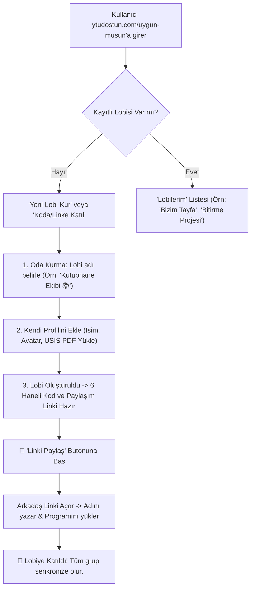
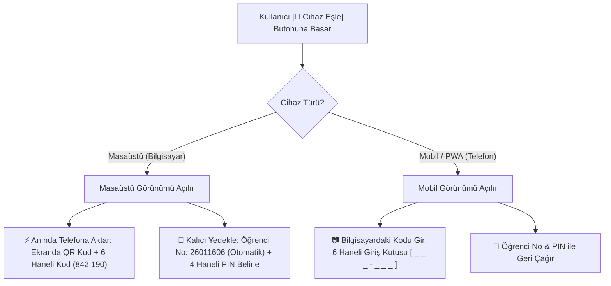

# 📋 YTÜ Dostun: Özellik Planı & Ürün Yol Haritası (FEATURE_PLAN)

Bu doküman, "YTÜ Dostun" platformunun sürüm bazlı özellik planlarını, detaylı teknik mimarisini, veri modellerini ve uygulama yol haritasını içerir.

---

# 📦 Sürüm 2.4: Çoklu Arkadaş Lobisi & Kampüs Sosyal Müsaitlik Platformu
> **Durum:** ✅ **GERÇEKLEŞTİRİLDİ** (Tüm aşamalar tamamlandı, test edildi ve canlıya alındı)

## 🎯 1. Ürün Vizyonu ve Kullanıcı Akışı



### 📱 Temel Ekranlar & Kullanıcı Deneyimi:
1. **Lobi Karşılama Ekranı (`/uygun-musun`):**
   - *"Arkadaşlarınla ne zaman buluşabileceğini tek tıkla gör!"*
   - **Aksiyonlar:** `[ ➕ Yeni Grup Lobisi Kur ]` ve `[ 🔗 Koda Sahip misin? Katıl ]`
   - **Kayıtlı Lobilerim:** Tarayıcı hafızasındaki (LocalStorage) odalar listelenir; kullanıcı tek dokunuşla önceki lobilerine dönebilir.

2. **Lobi Kurulum Sihirbazı (30 Saniye):**
   - **Lobi Adı:** Örn. *"Yemekçiler 🍕"*, *"EEF Bitirme Grubu"*, *"Hazırlık C1"*
   - **Kurucu Profili:** Ad, avatar seçimi ve ders programı (USIS PDF yükleme veya hızlı el ile ders seçimi).
   - **Yönetici Jetonu (Admin Token):** Kurucunun LocalStorage'ında saklanan gizli anahtar (üyeleri yönetme / lobi adını değiştirme / grubu kapatma yetkisi).

3. **📲 Gelişmiş Davet & Paylaşım Mekanizması:**
   - **Tek Dokunuşla "Paylaş" Butonu (`navigator.share`):**
     - Mobilde tıklandığında doğrudan telefonun yerel paylaşım sayfasını (WhatsApp, Instagram DM, Telegram, AirDrop, Mesajlar) açar.
   - **Masaüstü / Pano Kopyalama (Clipboard):** Masaüstünde linki anında panoya kopyalar ve toast bildirimi gösterir.
   - **Masa Başı QR Kod Kartı:** Kütüphanede yan yana otururken kamerayla okutup 5 saniyede katılması için modal içi QR kod.

---

## 👥 2. Çok Kişili (N-Kişi) Arayüz Mimarisi

- **Grup Nabzı (Group Pulse):** Müsait, Derste, Online Ders anlık sayıları ve tam kadro ortak boşluk pencereleri.
- **Üye Durum Izgarası (Member Cards):** Kalan süre sayaçları, canlı durumlar ve lider rozetleri.
- **Çoklu Paralel Çizelge (Group Timeline Matrix):** Tüm üyelerin ders bloklarının paralel akışı.
- **Gruba Genel Seslen (Broadcast Ping):** Tek tıkla kahve, kütüphane veya yemek çağrısı fırlatma.
- **Grup Yönetimi:** Gruptan çıkma, liderlik devri ve lider için grubu kapatma (silme) yetkisi.

---

## 🗺️ Sürüm 2.4 Uygulama Tablosu (Roadmap)

| Aşama | Başlık | Yapılacaklar | Durum |
| :--- | :--- | :--- | :--- |
| **Aşama 1** | **Backend Lobi API & Çakışma Motoru** | `/api/uygun-musun/create-room`, `/join`, `/my-rooms` uç noktaları. N-kişilik zaman dilimleme algoritması. | ✅ **Gerçekleştirildi** |
| **Aşama 2** | **Lobi Karşılama & Kurulum Arayüzü** | "Lobi Kur", "Koda Katıl", kayıtlı lobilerim çekmecesi ve USIS program yükleme sihirbazı. | ✅ **Gerçekleştirildi** |
| **Aşama 3** | **Paylaşım & Davet Sistemi** | Tek tıkla yerel mobil paylaşım butonu (`navigator.share`), pano kopyalama ve QR kod kartı. | ✅ **Gerçekleştirildi** |
| **Aşama 4** | **Çok Kişili Oda Paneli (Dashboard)** | Grup Nabzı, üye durum ızgarası, paralel çoklu çizelge ve toplu dürtme (Broadcast Ping). | ✅ **Gerçekleştirildi** |
| **Aşama 5** | **Grup İçi Web Push Bildirimleri** | Tüm lobi üyelerine anında kilit ekranı duyuru fırlatma. | ✅ **Gerçekleştirildi** |
| **Aşama 6** | **Grup Kapatma, Çıkma & Liderlik Devri** | Lider için odayı silme, üyeler için ayrılma ve otomatik liderlik transferi. | ✅ **Gerçekleştirildi** |
| **Aşama 7** | **Özel Sekme PWA Entegrasyonu** | Sekmeye özel manifest, bağımsız ana ekran kısayolları ve Mobil Uygun Musun görünümü. | ✅ **Gerçekleştirildi** |

---
---

# 🚀 Sürüm 2.5: Akıllı OBS Ayrıştırıcı, Katı Doğrulama ve Cihaz Senkronizasyonu (Sync)
> **Durum:** ✅ **GERÇEKLEŞTİRİLDİ (Tüm aşamalar tamamlandı, test edildi ve yerel doğrulamadan geçti)**

Bu sürüm; OBS'nin güncellenen yeni arayüzüne tam uyum sağlama, PDF yüklemelerinde sahte/uydurma dersleri ve geçersiz dosyaları engelleme, kullanıcı kılavuzunu modernize etme ve bilgisayar-telefon arasında şifresiz/bürokrasisiz cihaz senkronizasyonu sağlama özelliklerini kapsar.

---

## 📑 1. Yeni OBS Detay Yazdır Çıktısı (`std_time_table.aspx`) & Hibrit Ayrıştırıcı Detayları

### 🔍 A. Otomatik Format Tespiti (Hibrit Mimari)
Backend'deki `parse_student_schedule_endpoint` ve `parse_schedule_file_endpoint` fonksiyonları yüklenen PDF'in ilk sayfasındaki metin yapısını inceleyerek formatı otomatik belirler:
1. **Yeni OBS Formatı:** Belgede `std_time_table.aspx`, `Saat` + `Pazartesi` sütun başlıkları ve `Dönem:` meta bilgisi varsa **Yeni Izgara Ayrıştırıcısı** devreye girer.
2. **Eski OBS / USIS Formatı:** Belgede `Öğrenci Ders Programı` veya `Report.pdf` başlığı ve eski sütun çizgileri varsa **Mevcut Regex Ayrıştırıcısı** çalışır.
3. **YTÜ Dostun Formatı:** Sitemizden indirilen PDF veya tEXt metadata taşıyan PNG'ler doğrudan işlenir.
4. **Bilinmeyen / Geçersiz Dosya:** Hiçbir formata uymuyorsa anında `HTTP 400` fırlatılır.

### 📐 B. Yeni OBS Koordinat & Tablo Izgara Çözümlemesi
Yeni OBS çıktısı standart bir web yazdırma çıktısıdır (`std_time_table.aspx`). Milimetrik hücre sınırları belirlenir:
- **Sütun Aralıkları (X Eksenleri):**
  - `Saat`: $20 \le x < 82$
  - `Pazartesi`: $82 \le x < 177$
  - `Salı`: $177 \le x < 273$
  - `Çarşamba`: $273 \le x < 369$
  - `Perşembe`: $369 \le x < 464$
  - `Cuma`: $464 \le x < 560$
- **Satır Aralıkları (Y Eksenleri):**
  - $09:00 - 09:50$ ($y \in [110, 190]$)
  - $10:00 - 10:50$ ($y \in [190, 272]$)
  - $11:00 - 11:50$ ($y \in [272, 353]$)
  - $13:00 - 13:50$ ($y \in [353, 460]$)
  - $14:00 - 14:50$ ($y \in [460, 567]$)
  - $15:00 - 15:50$ ($y \in [567, 675]$)
  - $16:00 - 16:50$ ($y \in [675, 768]$)
  - $17:00 - 17:50$ ($y \in [768, 858]$)

### 🧬 C. Hücre İçi Akıllı Ayrıştırma Kuralları
Her bir hücre `pdfplumber.crop((x0, y0, x1, y1)).extract_text()` ile satır satır okunur:
1. **İkon ve Ders Kodu Satırı:**  
   `\uf02dBLM2012(2)` veya `\uf0c3BLM1011(1)`  
   - Regex: `([A-ZÇĞİÖŞÜ0-9_]{3,10})\(([0-9]+)\)`  
   - Ders Kodu: `BLM2012`, Şube No: `2`  
   - Laboratuvar Tespiti: İkon `\uf0c3` (erlenmayer) ise veya derslikte `LAB` geçiyorsa `is_lab = True`.
2. **Derslik ve Kontenjan Satırı:**  
   `EEF-D-B11[119]`, `BLM LAB[20]`, `Online[100]`  
   - Regex: `^(.*?)(?:\[(\d+)\])?$`  
   - Derslik: `EEF-D-B11`, Kontenjan: `119`
3. **Ders Adı (Çok Satırlı Metin):**  
   Ders kodu satırı ile Derslik satırı arasında kalan satırlar birleştirilir:  
   `"Nesneye Yönelik"` + `"Programlama"` $\longrightarrow$ `"Nesneye Yönelik Programlama"`
4. **Öğretim Görevlisi:**  
   Derslik satırından sonra gelen satırlar birleştirilir:  
   `"Dr.Öğretim Üyesi"` + `"FURKAN ÇAKMAK"` $\longrightarrow$ `"Dr.Öğretim Üyesi FURKAN ÇAKMAK"`
5. **Sayfa 2 Taşıntı Kontrolü:**  
   Tablonun altına taşan öğretim elemanı isimleri (örn. `SERTAÇ TEMUR`) ilgili son ders hücresine güvenle iliştirilir.

### ⏱️ D. Blok Birleştirme Algoritması
Aynı gün içinde aynı ders koduna, şubeye ve dersliğe sahip bitişik saat dilimleri (örn. Çarşamba 09:00-09:50, 10:00-10:50, 11:00-11:50) otomatik birleştirilerek tek bir **09:00 - 11:50** bloğu oluşturulur.

### 👤 E. Öğrenci Meta Bilgisi Otomatik Çekimi
PDF'in 2. satırından Regex ile:
`^(\d{7,10})\s+([A-ZÇĞİÖŞÜ\s]+?)\s*\((.*?)\)\s*Dönem:\s*(.*)$`
- **Öğrenci No:** `26011606`
- **Ad Soyad:** `ATİLLA ÇIRAK`
- **Bölüm:** `Elektrik-Elektronik / Bilgisayar Mühendisliği`
- **Dönem:** `2026-2027 Güz`
*(Bu veriler sayesinde Uygun Musun profil oluşturma ekranında öğrencinin adı otomatik doldurulur).*

---

## 🛡️ 2. Katı PDF Doğrulama & Sahte Ders Engelleme Detayları

### 🚫 A. "Ders" Adında Uydurma/Tahmini Ders Üretiminin Engellenmesi
- **Eski Problem:** `backend/main.py` ve `frontend/src/utils/pngOcrParser.ts` dosyalarında regex eşleşmediğinde `code = 'Ders'` ataması yapılıyor ve leke/çizgilerden sahte dersler uyduruluyordu.
- **Kesin Çözüm:**  
  `code = 'Ders'` fallback'i tamamen kaldırılacak.  
  Sadece standart YTÜ formatına (`[A-ZÇĞİÖŞÜ]{2,5}\s*\d{3,4}`) uyan veya SQLite `courses` veritabanında karşılığı olan dersler sisteme eklenecek. Eşleşmeyen metin parçaları sessizce göz ardı edilecek.

### 🔒 B. Asgari Ders Sayısı Şartı ($\ge 1$ Ders) & Geçersiz Dosya Reddi
- Dosyadan çıkarılan haftalık toplam ders sayısı $0$ ise:
  - Backend anında `HTTP 400` döner:
    `"Yüklenen dosya geçerli bir YTÜ ders programı içermiyor veya hiç ders bulunamadı. Lütfen OBS'den 'Detay Yazdır > PDF' ile indirdiğiniz resmi ders programını yükleyin."`
  - Frontend (`uygun-musun/page.tsx` ve ana sayfa) boş program yüklenmesine izin vermez, kullanıcıya kırmızı uyarı kartı ve kılavuz gösterir.

### 📖 C. Modernize Edilmiş Kullanıcı Kılavuzu & İpuçları
- **Ana Sayfa & Uygun Musun Upload Alanı:**
  Eski "Report.pdf Yükle" yerine:
  > **Yıldız Teknik Üniversitesi — Güncel OBS İndirme Adımları:**  
  > **1.** OBS'ye giriş yapıp sol menüden **Ders Programı** ekranına gidin.  
  > **2.** Sağ üstteki **Yazdır** butonuna, ardından **Detay Yazdır** seçeneğine tıklayın.  
  > **3.** Yazıcı açılır penceresinde **Hedef: PDF Olarak Kaydet** seçeneğini seçip indirin ve buraya yükleyin.  
  > *(Eski USIS/Report.pdf çıktıları da desteklenmektedir).*

---

## 📲 3. Cihazlar Arası Senkronizasyon (Device Sync) Detayları

### 🗄️ A. Veritabanı Mimarisi (SQLite WAL Modu)
`backend/uygun_musun.db` içine eklenecek iki hafif tablo:

```sql
-- 1. Kalıcı Eşleme Tablosu (Öğrenci No + 4 Haneli PIN)
CREATE TABLE IF NOT EXISTS sync_accounts (
    student_id TEXT PRIMARY KEY,       -- Örn: '26011606'
    pin_hash TEXT NOT NULL,            -- PBKDF2/SHA-256 ile tuzlanmış PIN hash'i
    payload TEXT NOT NULL,             -- JSON: schedule, course_notes, courses_summary, saved_lobbies
    updated_at TIMESTAMP DEFAULT CURRENT_TIMESTAMP
);

-- 2. Anlık Transfer Tablosu (WhatsApp Web Tarzı Tek Seferlik Kod)
CREATE TABLE IF NOT EXISTS ephemeral_transfers (
    transfer_code TEXT PRIMARY KEY,    -- 6 Haneli Benzersiz Kod (Örn: '742190')
    payload TEXT NOT NULL,             -- JSON: Aktarılacak tüm veriler
    created_at TIMESTAMP DEFAULT CURRENT_TIMESTAMP,
    expires_at TIMESTAMP NOT NULL      -- 5 dakika ömürlü (TTL)
);
```

### 🔌 B. REST API Uç Noktaları

| Metot | Uç Nokta | Parametreler | Açıklama |
| :--- | :--- | :--- | :--- |
| `POST` | `/api/sync/save` | `{ student_id, pin, payload }` | Öğrenci No ve 4 haneli PIN ile buluta kaydeder/günceller. |
| `POST` | `/api/sync/load` | `{ student_id, pin }` | Öğrenci No ve PIN doğrularsa cihaz verisini döner. |
| `POST` | `/api/sync/transfer/create` | `{ payload }` | Bilgisayar veriyi atar; 5 dakikalık 6 haneli kod ve QR verisi döner. |
| `GET` | `/api/sync/transfer/{code}` | - | Mobil kodu girer veya QR okutur; veriyi tek seferlik çeker ve veritabanından siler. |

### 📦 C. Senkronize Edilecek Veri Paketi (Payload JSON)
```json
{
  "student_id": "26011606",
  "student_name": "ATİLLA ÇIRAK",
  "term": "2026-2027 Güz",
  "schedule": { "Pazartesi": [...], "Salı": [...], ... },
  "course_notes": { "BLM2012": "Hoca vizeye 3. haftadan dahil etti" },
  "courses_summary": [...],
  "saved_lobbies": [
    { "room_code": "KUTUP5", "title": "Kütüphane Ekibi 📚", "joined_at": 1730850000 }
  ],
  "exported_at": 1730850123456
}
```

### 📱 D. Kullanıcı Arayüzü & Akıllı Cihaz Algılama (`DeviceSyncModal.tsx`)
Header'ın sağ üstünde ve Uygun Musun araç çubuğunda **[ 📲 Cihaz Eşle ]** butonu yer alır.



---

## 🗺️ Sürüm 2.5 Detaylı Uygulama Tablosu (Roadmap)

| Aşama | Başlık | Detaylı Yapılacaklar Listesi | Durum |
| :--- | :--- | :--- | :--- |
| **Aşama 1** | **Yeni OBS Çıktısı (`std_time_table.aspx`) Ayrıştırıcı Motoru** | • `pdfplumber` ile koordinat tabanlı hücre ızgarası okuma.<br>• İkon (`\uf02d`, `\uf0c3`), kod, şube, derslik, kontenjan, çok satırlı ders adı ve hoca regex ayrıştırıcısı.<br>• Bitişik saat bloklama (09:00 - 11:50).<br>• Öğrenci No, Ad Soyad, Bölüm ve Dönem üst bilgi çekimi.<br>• Eski USIS formatı ile hibrit çalışma. | ✅ **Gerçekleştirildi** |
| **Aşama 2** | **Katı PDF Doğrulama & Sahte Ders Temizliği** | • `parse_schedule_image_ytu` ve `pngOcrParser.ts` içindeki `code = 'Ders'` uydurmasını silme.<br>• Format dışı karakterleri eleme.<br>• Toplam 0 ders ayrıştırılırsa `HTTP 400` ile geçersiz dosya hatası fırlatma.<br>• Frontend'de 0 ders kontrolü ve kullanıcıya net hata kartı. | ✅ **Gerçekleştirildi** |
| **Aşama 3** | **Arayüz & OBS Yeni Kılavuz Güncellemesi** | • Ana sayfa upload kartına "Yazdır > Detay Yazdır > PDF" 3 adımlı rehberi entegre etme.<br>• Uygun Musun sayfasındaki PDF yükleme modalı yardım baloncuğunu güncelleme.<br>• Yeni OBS PDF'i yüklendiğinde öğrencinin adını profil alanına otomatik yazma. | ✅ **Gerçekleştirildi** |
| **Aşama 4** | **Backend Senkronizasyon Altyapısı (SQLite + API)** | • `sync_accounts` ve `ephemeral_transfers` tablolarını oluşturma.<br>• `/api/sync/save`, `/api/sync/load`, `/api/sync/transfer/create`, `/api/sync/transfer/{code}` endpoint'leri.<br>• 5 dakikalık TTL temizleme mekanizması. | ✅ **Gerçekleştirildi** |
| **Aşama 5** | **Frontend "Cihaz Eşle" Modalı & Akıllı Cihaz Tespiti** | • `frontend/src/components/DeviceSyncModal.tsx` bileşenini yazma.<br>• `navigator.userAgent` & ekran genişliği ile PC vs Mobil ayrımı.<br>• PC için dinamik QR Kod + 6 haneli kod üretimi.<br>• Mobil için kod yazma ve PIN ile geri yükleme arayüzü.<br>• Header ve Uygun Musun sayfasına entegrasyon. | ✅ **Gerçekleştirildi** |
| **Aşama 6** | **Test, Doğrulama & Canlı Dağıtım** | • Kullanıcının eklediği gerçek PDF ile backend ayrıştırma testi.<br>• TypeScript (`tsc --noEmit`) ve Next.js build kontrolü.<br>• EC2 dağıtımı için komutların hazırlanması. | ✅ **Gerçekleştirildi** |
