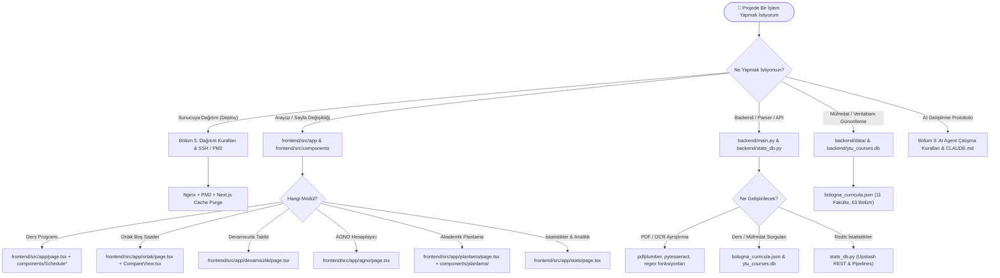
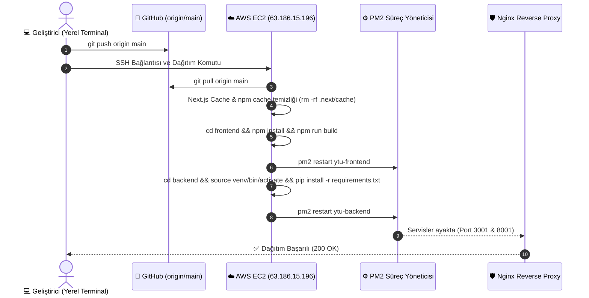
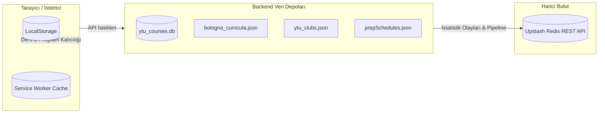

# 🧭 YTÜ Dostun - Master Sistem Kılavuzu (KILAVUZ.md)

Bu belge, **YTÜ Dostun** platformunun mimarisini, dizin yapısını, veri akışını, dağıtım süreçlerini ve geliştirici/yapay zeka (AI Agent) çalışma protokollerini tek bir çatı altında toplayan ana referans dokümanıdır.

---

## 📌 1. Üst Bilgi & Proje Kartı (Metadata)

| Özellik | Bilgi |
| :--- | :--- |
| **Proje Adı** | **YTÜ Dostun** (Yıldız Teknik Üniversitesi Öğrenci Destek Platformu) |
| **Proje Amacı** | YTÜ öğrencilerinin USIS/Bologna ders programlarını görselleştirmesi, ortak boş saatleri bulması, devamsızlık takibi yapması, AGNO simülasyonu ve 4 yıllık mezuniyet planlaması gerçekleştirmesini sağlayan hepsi bir arada açık web platformu. |
| **Mimari Türü** | **Decoupled Client-Server (Ayrık İstemci-Sunucu):** <br>• **Frontend:** Next.js 16 (App Router) + React 19 + Tailwind CSS v4 + PWA <br>• **Backend:** FastAPI (Python 3.10+) + Uvicorn + pdfplumber + PyTesseract <br>• **Veri Katmanı:** SQLite3 (`ytu_courses.db`) + Upstash Redis REST API + Statik/Dinamik JSON Veri Setleri |
| **Canlı Domainler** | [https://ytudostun.com](https://ytudostun.com) & [https://www.ytudostun.com](https://www.ytudostun.com) *(Eski Vercel adresi `ytuprogram.vercel.app` kalıcı olarak buraya yönlendirilir)* |
| **GitHub Repo** | `https://github.com/atillacirak/ytu-program-gorsellestirici.git` (Ana Dal: `main`) |
| **Sunucu (Production)** | **Amazon Web Services (AWS EC2)** • Ubuntu 22.04 LTS • Statik IP: `63.186.15.196` |
| **Süreç Yöneticisi** | **PM2:** `ytu-frontend` (Port 3001), `ytu-backend` (Port 8001), `kiribot` |
| **Web / Reverse Proxy** | **Nginx:** SSL sonlandırma, `/api/` -> `127.0.0.1:8001`, `/` -> `127.0.0.1:3001` |
| **Yerel Ortam (Dev)** | Frontend: `http://localhost:3000` • Backend: `http://127.0.0.1:8000` |

---

## 🧭 2. Dokümantasyon Haritası & Master Index

### 🗺️ "Ne Yapmak İstiyorsun?" - Geliştirici ve AI Yol Haritası



### 📚 Mevcut Dokümantasyon Dosyaları Görev Dağılımı

| Belge Adı | Dosya Yolu | Amacı | Ne Zaman Okunmalı? | İlgili Kaynak Kodlar |
| :--- | :--- | :--- | :--- | :--- |
| **KILAVUZ.md** *(Master)* | `KILAVUZ.md` | Sistemin tek noktadan eksiksiz mimari, dizin, dağıtım ve protokol kılavuzu. | Projeye ilk girişte, mimari kararlarda ve deploy öncesinde. | Tüm repository (`frontend/`, `backend/`, `ytudostun.conf`) |
| **changelog.md** | `changelog.md` | Sürümler arası özellikler, bugfix'ler ve refactor geçmişi. | Geçmiş kararları, sürüm tarihlerini ve tamamlanan özellikleri incelerken. | Tüm commit geçmişi ve versiyonlar |
| **README.md** *(Kök)* | `README.md` | Repo karşılama dosyası. | GitHub üzerinde depoyu incelerken. | Kök dizin |
| **frontend/README.md** | `frontend/README.md` | Next.js varsayılan başlangıç rehberi. | Frontend yerel sunucuyu (`npm run dev`) ayağa kaldırırken. | `frontend/package.json` |
| **frontend/AGENTS.md** | `frontend/AGENTS.md` | Next.js 16 breaking change uyarıları ve agent direktifleri. | AI kod üretirken Next.js 16 kurallarını hatırlaması gerektiğinde. | `frontend/src/app/` |
| **frontend/CLAUDE.md** | `frontend/CLAUDE.md` | Claude / LLM araçları için yönlendirme pointer'ı (`@AGENTS.md`). | LLM asistanları context yüklerken. | `frontend/` |

---

## 🤖 3. Yapay Zeka (AI Agent) İçin Adım Adım Çalışma Protokolü

Projeye dahil olan tüm yapay zeka ajanlarının (Antigravity, Claude, Cursor, Copilot vb.) sistemi bozmaması için aşağıdaki altın kurallara sıkı sıkıya uyması zorunludur:

### 🌟 Altın Kurallar & Mimari Bütünlük
1. **Modüler Bileşen Yapısını Koruyun (Re-monolithing Yasağı):**
   - `frontend/src/app/page.tsx` v2.1 sürümünde devasa halinden parçalanmıştır. Yeni özellik eklerken bileşenleri yeniden `page.tsx` içine yığmayın; ilgili parçalara ayırın:
     - `UploadScreen.tsx`: Dosya yükleme ve karşılama vitrini.
     - `ScheduleToolbar.tsx`: Filtreler, butonlar, mod geçişleri.
     - `ScheduleTable.tsx`: A4 matrisi ve ders blokları.
     - `CourseSummaryTable.tsx`: Ders listesi ve derslik özet tablosu.
     - `EditCourseModal.tsx`: Ders düzenleme penceresi.
2. **Next.js 16 & React 19 Uyumuna Dikkat Edin:**
   - Next.js 16 App Router mimarisinde `useSearchParams()` statik build sırasında derleme hatasına yol açabilir. Dinamik arama parametresi gereken yerleri `Suspense` sınırları içerisine alın veya doğrudan bağımsız sayfa rotaları kullanın (Örn: `/ortak`, `/devamsizlik`, `/agno`, `/planlama`, `/stats`).
   - React 19 kancaları ve istemci direktifleri (`"use client"`) için bileşen sınırlarını doğru belirleyin.
3. **Tailwind CSS v4 Sözdizimini Koruyun:**
   - Projede Tailwind v4 kullanılmaktadır (`@tailwindcss/postcss`). Konfigürasyon `globals.css` içinde `@import "tailwindcss";` şeklindedir; klasik v3 `tailwind.config.js` kuralları ile ezilmemelidir.
4. **Veri Kalıcılığı Protokolü (`useLocalStorageState`):**
   - Kullanıcının ders programı (`visualizerData`), notları (`courseNotes`), filtre tercihleri ve planlama adımları tarayıcı hafızasında saklanır.
   - Ham `localStorage.getItem/setItem` çağrıları yerine daima SSR uyumlu ve hidrasyon hatası (hydration mismatch) üretmeyen `frontend/src/hooks/useLocalStorageState.ts` kancasını kullanın.
5. **Kod Açıklamaları ve Dokümantasyon Sadakati:**
   - Var olan Türkçe/İngilizce kod içi yorum satırlarını, JSDoc bloklarını ve Python type hinting/docstring tanımlarını silmeyin.
6. **Öğrenci Verisi ve Gizlilik (PII Strip):**
   - Yüklenen transkript ve programlardan isim, öğrenci no veya T.C. kimlik numarası asla kalıcı kaydedilmemeli; backend'de `data.pop('student_id', None)` protokolü korunmalıdır.
7. **Bağımlılık ve Paket Yönetimi:**
   - Frontend bağımlılıkları sadece `frontend/` dizininde `npm install` ile yüklenmelidir.
   - Backend bağımlılıkları sanal ortamda (`venv`) `pip install -r requirements.txt` ile yönetilmelidir.

---

## 📁 4. Proje Dizin Yapısı & Modül Haritası

```
c:\Projeler\Ytü Görselleştir\
├── .gitignore                      # Git takip dışı dosyalar (.env, .next, venv, pem)
├── changelog.md                    # Sürüm değişiklik günlüğü (v2.0 -> v2.3+)
├── fix_header.py                   # Header bileşeni acil yama script'i (bakım amaçlı)
├── KILAVUZ.md                      # [BU DOSYA] Master Sistem ve Dağıtım Kılavuzu
├── netlify.toml                    # Netlify alternatif barındırma yapılandırması
├── README.md                       # Kök seviye depo başlık dosyası
├── ytudostun.conf                  # Production Nginx reverse proxy yapılandırma dosyası
│
├── backend/                        # 🐍 FastAPI Asenkron Python Backend
│   ├── .env                        # Upstash Redis REST URL & Token ve fallback sayaçları
│   ├── main.py                     # FastAPI ana API rotaları, PDF & OCR ayrıştırıcıları
│   ├── requirements.txt            # Python kütüphane bağımlılıkları
│   ├── stats_db.py                 # Upstash Redis pipeline & istatistik analitik motoru
│   ├── ytu_courses.db              # SQLite dersler, şubeler, saatler ve bölümler tablosu
│   ├── ytu_clubs.json              # 69 adet YTÜ öğrenci kulübü ve kategori verileri
│   ├── prepSchedules.json          # Hazırlık sınıfları A/B/C kuru haftalık programları
│   ├── prep_schedule.pdf           # Hazırlık referans program PDF'i
│   ├── diagnose_prep.py            # Hazırlık programı ayrıştırma test script'i
│   ├── test_prep.py                # Hazırlık parser birim testleri
│   └── data/                       # Bologna Akademik Müfredat Veri Seti
│       ├── bologna_curricula.json  # 11 Fakülte, 63 Lisans Programının 8 yarıyıllık dersleri
│       └── bologna_all_bachelor_courses.json # 4,685 adet lisans dersinin ön koşul ve AKTS verisi
│
└── frontend/                       # ⚡ Next.js 16 + React 19 + Tailwind v4 Frontend
    ├── .env.local                  # NEXT_PUBLIC_API_URL (http://127.0.0.1:8000 veya prod)
    ├── package.json                # Next.js, Lucide, Tesseract.js, PWA bağımlılıkları
    ├── next.config.ts              # Domain yönlendirmeleri, PWA ve redirect kuralları
    ├── postcss.config.mjs          # Tailwind CSS v4 PostCSS eklenti ayarı
    ├── tsconfig.json               # TypeScript path alias (@/* -> ./src/*) tanımları
    ├── AGENTS.md / CLAUDE.md       # AI modelleri için Next.js 16 direktifleri
    ├── public/                     # Statik görseller, PWA manifest, service worker (sw.js)
    └── src/
        ├── app/                    # Next.js App Router Rotaları
        │   ├── layout.tsx          # Kök HTML iskeleti, Geist fontları, Analytics & Header
        │   ├── globals.css         # Tailwind v4 importları ve global CSS değişkenleri
        │   ├── manifest.ts         # PWA Web App Manifest üreticisi
        │   ├── page.tsx            # [/] Ders Programı Görselleştirici Ana Sayfası
        │   ├── ortak/page.tsx      # [/ortak] Ortak Boş Saatler Karşılaştırma Sayfası
        │   ├── devamsizlik/page.tsx# [/devamsizlik] Devamsızlık Takibi & Aylık Yoklama Takvimi
        │   ├── agno/page.tsx       # [/agno] AGNO Hesaplayıcı & Dönem Not Senaryoları
        │   ├── planlama/page.tsx   # [/planlama] 4 Yıllık Akademik Planlama & Mezuniyet Simülatörü
        │   └── stats/page.tsx      # [/stats] Upstash Redis Gerçek Zamanlı İstatistik Paneli
        ├── components/             # Yeniden Kullanılabilir UI Bileşenleri
        │   ├── Header.tsx          # Üst navigasyon çubuğu, modül linkleri ve yenilikler butonu
        │   ├── UploadScreen.tsx    # PDF/Görsel yükleme alanı ve Araç Tanıtım Vitrini
        │   ├── ScheduleToolbar.tsx # Program filtreleme, indirme, mod ve aktarım butonları
        │   ├── ScheduleTable.tsx   # A4 yatay/dikey ders çizelge matrisi ve renkli kartlar
        │   ├── CourseSummaryTable.tsx # Ders listesi, sınıf kodları ve hoca özet tablosu
        │   ├── EditCourseModal.tsx # Ders adı, sınıfı, saati ve not düzenleme penceresi
        │   ├── CompareView.tsx     # Ortak boş saatler matrisi (busyMap O(1) hash haritası)
        │   ├── WhatsNewModal.tsx   # Sürüm yenilikleri karşılama penceresi
        │   ├── DevColorPanel.tsx   # Geliştirici renk paleti yönetim paneli
        │   ├── PrivacyModal.tsx    # KVKK ve Öğrenci Verisi Gizlilik Politikası modalı
        │   ├── AnimatedCounter.tsx # İstatistik sayacı akıcı sayı animatörü
        │   └── planlama/           # Akademik Planlama Modülüne Özel Bileşenler
        │       ├── PlanlamaHero.tsx       # Fakülte/bölüm seçimi, transkript yükleme & özet
        │       ├── PlanlamaToolbar.tsx    # Kredi/AKTS sınır butonları, PDF indir, sıfırla
        │       ├── SemesterBucketCard.tsx # Yarıyıl ders kovaları, sürükle-bırak & kartlar
        │       └── PlanlamaModals.tsx     # Seçmeli ders havuzu, ders ekleme & detay modalları
        ├── hooks/
        │   └── useLocalStorageState.ts    # SSR & hydration güvenli reaktif LocalStorage kancası
        ├── types/
        │   ├── index.ts            # Ders programı, zaman dilimi ve parser tipleri
        │   └── planlama.ts         # Bologna müfredat, kova (bucket) ve kural doğrulama tipleri
        ├── data/
        │   └── prepSchedules.json  # İstemci tarafında tembel yüklenen (lazy) hazırlık verisi
        └── utils/
            ├── planlamaUtils.ts    # Ön koşul doğrulama, dönem kuralları ve kredi limit motoru
            ├── planlamaPdfExport.ts# pdfmake ile yüksek kaliteli vektörel A4 plan PDF çıktısı
            ├── pngMetadata.ts      # PNG tEXt chunk içine program JSON gömme ve okuma
            ├── pngOcrParser.ts     # İstemci taraflı Tesseract.js fallback OCR motoru
            └── instructors.ts      # Hoca isimleri ve kısaltma eşleme sözlüğü
```

---

## 🚨 5. Canlıya Alma ve Dağıtım (Deployment) Kuralları

Sunucu ortamı AWS EC2 üzerinde çalışan bir Ubuntu sanal makinesidir. Frontend ve Backend süreçleri **PM2** ile arka planda kesintisiz çalıştırılmakta, internet trafiği **Nginx** üzerinden yönlendirilmektedir.

### 🌐 Dağıtım Mimarisi ve Bilgileri
- **Sunucu IP:** `63.186.15.196`
- **Kullanıcı:** `ubuntu`
- **SSH Anahtarı:** `kiribot-key.pem`
- **Sunucu Proje Yolu:** `~/ytu-dostun`
- **PM2 Süreçleri:** `ytu-frontend` (Port 3001), `ytu-backend` (Port 8001)

### 🔄 Dağıtım Sıralaması (Sequence Diagram)



---

### ⚡ Tek Satırda Hızlı Dağıtım Komutu (Local Terminal)

Yerel Windows PowerShell veya terminalinizden tek komutla sunucudaki kodları güncelleyip yeniden derlemek için:

```powershell
ssh -o StrictHostKeyChecking=no -i "C:\Projeler\kiribot-key.pem" ubuntu@63.186.15.196 "cd ~/ytu-dostun && git pull origin main && rm -rf frontend/.next/cache && rm -rf ~/.npm/_cacache && cd frontend && npm install && npm run build && pm2 restart ytu-frontend && cd ../backend && source venv/bin/activate && pip install -r requirements.txt && pm2 restart ytu-backend"
```

---

### 🛠️ Adım Adım Manuel Dağıtım Protokolü

Sunucuya doğrudan SSH ile bağlanıp kontrollü deploy yapmak istediğinizde:

```bash
# 1. AWS Sunucusuna Bağlanın
ssh -i "kiribot-key.pem" ubuntu@63.186.15.196

# 2. Proje Dizinine Geçin ve Son Kodları Çekin
cd ~/ytu-dostun
git status
git pull origin main

# 3. Frontend'i Derleyin ve Yeniden Başlatın
cd ~/ytu-dostun/frontend
rm -rf .next/cache                 # Olası derleme önbellek çakışmalarını önler
npm install
npm run build
pm2 restart ytu-frontend

# 4. Backend'i Güncelleyin ve Yeniden Başlatın
cd ~/ytu-dostun/backend
source venv/bin/activate
pip install -r requirements.txt
pm2 restart ytu-backend

# 5. Süreç Durumlarını Kontrol Edin
pm2 status
```

### ⚠️ Kritik Dağıtım Uyarıları
> [!IMPORTANT]
> - **Port Ayrımı:** Nginx yapılandırmasında (`ytudostun.conf`) backend **8001**, frontend **3001** portuna yönlendirilir. Yerel geliştirmede kullanılan 8000 ve 3000 portları sunucuda farklı servislerle çakışmaması için 8001 ve 3001 olarak ayarlanmıştır.
> - **Next.js Cache:** `rm -rf frontend/.next/cache` adımı atlanırsa Next.js bazen eski JS chunk'larını sunmaya devam edebilir. Build öncesi temizlenmesi esastır.
> - **Bellek (RAM) Sınırı:** EC2 t2.micro veya t3.micro gibi düşük bellekli makinelerde `npm run build` anında Swap alanı yetersiz kalırsa OOM (Out of Memory) oluşabilir. Sunucuda 2GB+ Swap alanı tanımlı olduğundan emin olun.

---

## ⚙️ 6. Çekirdek Modüller, Veri Akışı & Mimari Özeti

Platform 6 ana kullanıcı modülünden ve bunları destekleyen ayrık servislerden oluşur:

### 1. Ders Programı Görselleştirici (`/`)
- **İşlev:** USIS ders programı PDF'i veya YTÜ Yabancı Diller Yüksekokulu hazırlık programlarını modern, A4 baskısına ve PNG çıktısına uygun bir haftalık çizelgeye dönüştürür.
- **Akıllı Özellikler:**
  - PNG çıktısına `pngMetadata.ts` ile program JSON verisi tEXt chunk olarak gömülür. Kullanıcı daha sonra bu görseli yüklediğinde OCR'a gerek kalmadan 0 ms gecikmeyle programı birebir geri yükler.
  - Hazırlık sınıfları için binlerce satırlık `prepSchedules.json` statik yüklenmez; sadece kullanıcı hazırlık sekmesini seçtiğinde dinamik `import()` ile istemciye çekilir (Lazy Loading).
  - Tek tıkla programı `/devamsizlik` ve `/agno` sayfalarına aktaran akıllı köprüler sunar.

### 2. Ortak Boş Saatler (`/ortak`)
- **İşlev:** Birden fazla öğrencinin PDF veya ekran görüntülerini yükleyerek herkesin aynı anda boş olduğu ders saatlerini renkli ısı matrisiyle tespit eder.
- **Performans Optimizasyonu:** Hücre başına O(N³) hesaplama yerine, tüm öğrencilerin programları tek bir `busyMap` hash tablosuna O(1) erişimle önceden derlenir (`useMemo`).

### 3. Devamsızlık Takibi (`/devamsizlik`)
- **İşlev:** Ders bazında devamsızlık saatlerini, yüzdelik limitleri ve resmi tatilleri yönetir.
- **Özellikler:** İnteraktif aylık takvim, 2 haftada bir yapılan laboratuvar frekansları, limit ve yüzde çift yönlü senkronizasyonu, programdan aktarılan Lab ve Teori derslerinin çakışmasız benzersiz ID mimarisi (`usedIds`).

### 4. AGNO & Not Simülatörü (`/agno`)
- **İşlev:** USIS veya e-Devlet transkript PDF'inden mevcut AGNO ve tamamlanan krediyi okur; gelecek dönem dersleri için harf notu senaryoları simüle eder.
- **Otomatik Kredi Tamamlama:** Ders kodu girildiğinde backend SQLite veritabanından (`/api/course-lookup`) kredileri otomatik çeker.
- **Planlama Köprüsü:** Transkript yüklendiğinde tek tıkla `/planlama` sayfasına geçiş butonu sunar.

### 5. Akademik Planlama & Mezuniyet Simülatörü (`/planlama`)
- **İşlev:** 11 Fakülte ve 63 Lisans Programının Bologna müfredatını (`bologna_curricula.json`) 8 yarıyıl + Yaz okulları kovalarına (bucket) dizer.
- **Kural Motoru:**
  - Zorunlu Güz derslerinin sadece Güz dönemlerine, Bahar derslerinin Bahar dönemlerine konabilmesi.
  - Dönemlik 42 AKTS veya 24/28 Yerel Kredi sınır kontrolü.
  - Ön koşul zincir denetimi (`extractPrereqCodes`).
  - Vektörel, metinleri seçilebilir A4 yatay plan PDF çıktısı (`planlamaPdfExport.ts` - `pdfmake`).

### 6. Canlı Analitik & İstatistikler (`/stats`)
- **İşlev:** Upstash Redis tabanlı anlık ziyaretçi, program oluşturma ve modül etkileşim sayaçları.
- **Zaman Pencereleri:** 24 saat, 7 gün, 30 gün ve Tüm Zamanlar bazında yüzdelik değişim trendleri (`+/- %`).
- **Grafik:** Harici kütüphane bağımlılığı olmadan saf Tailwind CSS ile oluşturulmuş responsive aktivite sütun grafiği.

---

### 🗄️ Veri Tabanı ve Depolama Katmanı



1. **SQLite (`backend/ytu_courses.db`):**
   - `departments`: Bölüm adları ve kodları.
   - `courses`: Ders kodu, adı, kredisi, AKTS'si, öğretim görevlisi, online/örgün durumu.
   - `sections`: Şube numaraları (`Gr1`, `Gr2`) ve sorumlu hocalar.
   - `time_slots`: Derslerin haftalık gün, başlangıç, bitiş saatleri ve derslikleri.
2. **Bologna Müfredat Verisi (`backend/data/bologna_curricula.json`):**
   - 11 Fakülte, 63 Bölüm. Her bölümün 8 yarıyıllık zorunlu dersleri, seçmeli ders grupları ve ön koşul şartları. MTime kontrolü ile bellekte önbelleklenir (`_load_curricula`).
3. **Upstash Redis REST (`stats_db.py`):**
   - Küresel sayaçlar: `total_visits`, `total_generated`, `total_generated_pdf`, `total_generated_prep`, `total_gano_visits`, `total_gano_scenarios`, `total_devamsizlik_visits`, `total_planlama_visits`.
   - Zaman pencereli Sorted Set'ler (ZSET): `z:<field>` -> Timestamp skoru ile 60 günlük pencere tutulur; 60 günden eski olaylar pipeline içinde `ZREMRANGEBYSCORE` ile otomatik silinir.

---

### 🔌 API Uç Noktaları (Endpoints) Kataloğu

| Yöntem | Endpoint | Parametre / Body | Açıklama |
| :--- | :--- | :--- | :--- |
| `GET` | `/` | - | Backend sağlık kontrolü (Healthcheck). |
| `POST` | `/api/parse-student-schedule` | `file: UploadFile` (PDF) | USIS Ders Programı PDF'ini ayrıştırır; derslikleri, saatleri ve hocaları döndürür. |
| `POST` | `/api/parse-schedule-file` | `file: UploadFile` (PDF/PNG/JPG) | PDF veya PNG program dosyasını ayrıştırır. PNG ise önce tEXt metadata arar, yoksa PyTesseract OCR devreye girer. |
| `POST` | `/api/parse-transcript` | `file: UploadFile` (PDF) | OBS / e-Devlet transkriptinden AGNO, kredi, alınan dersler ve otomatik bölüm tespiti yapar. |
| `GET` | `/api/course-lookup` | `code`, `name` | Veritabanında ders arar; kod, isim, kredi ve AKTS döner. |
| `GET` | `/api/curricula/programs` | - | Tüm fakülte ve lisans programlarının listesini döner. |
| `GET` | `/api/curricula/program/{id}` | `id: str` | Belirtilen lisans programının 8 yarıyıllık tam Bologna müfredatını döner. |
| `GET` | `/api/stats` | `period: all \| 24h \| 7d \| 30d` | Redis'ten istatistik sayaçlarını ve trend yüzdelerini çeker. |
| `POST` | `/api/stats/visit` | - | Ana sayfa ziyaret sayacını artırır. |
| `POST` | `/api/stats/generate` | `source: pdf \| prep` | Üretilen program sayacını (PDF/Hazırlık ayrımıyla) artırır. |
| `POST` | `/api/stats/gano-visit` | - | AGNO sayfası ziyaret sayısını artırır. |
| `POST` | `/api/stats/gano-scenario` | - | Simüle edilen not senaryosu sayısını artırır. |
| `POST` | `/api/stats/devamsizlik-visit` | - | Devamsızlık sayfası ziyaret sayısını artırır. |
| `POST` | `/api/stats/planlama-visit` | - | Akademik planlama sayfası ziyaret sayısını artırır. |

---

## 🛡️ 7. Güvenlik, Gizlilik & Ortam Değişkenleri (.env) Protokolü

### 🔐 Ortam Değişkenleri Kataloğu

#### Backend Ortam Değişkenleri (`backend/.env`):
```env
# Upstash Redis REST Bağlantı Bilgileri (Analitik ve Sayaçlar İçin)
UPSTASH_REDIS_REST_URL="https://your-upstash-redis-url.upstash.io"
UPSTASH_REDIS_REST_TOKEN="your-upstash-rest-token"

# Opsiyonel: Redis Çökmesi Halinde Kullanılacak Taban (Fallback) Değerler
STATS_BASE_GENERATED=0
STATS_BASE_VISITS=0
STATS_BASE_GANO_VISITS=0
STATS_BASE_GANO_SCENARIOS=0
STATS_BASE_GENERATED_PDF=783
STATS_BASE_GENERATED_PREP=131
STATS_BASE_DEVAMSIZLIK_VISITS=0
STATS_BASE_PLANLAMA_VISITS=0
```

#### Frontend Ortam Değişkenleri (`frontend/.env.local`):
```env
# Backend API Adresi (Yerel geliştirmede 8000, production'da sunucu proxy kullanılır)
NEXT_PUBLIC_API_URL=http://127.0.0.1:8000
# Veya production ortamı için:
# NEXT_PUBLIC_API_URL=https://ytudostun.com
```

---

### 🚫 Git'e Asla Eklenmemesi Gereken Dosyalar (`.gitignore`)
Aşağıdaki dosyalar ve uzantılar kişisel veriler, sunucu anahtarları ve derleme artıkları içerdiğinden depoya **kesinlikle commitlememelidir**:
- `*.env`, `.env.local`, `.env.*`
- `*.pem`, `kiribot-key.pem` *(AWS SSH Özel Anahtarları)*
- `backend/venv/`, `node_modules/`, `frontend/.next/`
- `*.sqlite3-journal`, `backend/stats.db`
- `actual_ocr_words.json`, `extracted_chat_dialog.txt`, `chatgpt_page.html`

---

### 👤 KVKK & Öğrenci Mahremiyeti Standartları
YTÜ Dostun, öğrenci mahremiyetine ve veri egemenliğine en üst düzeyde saygı gösterir:
1. **Sıfır Kalıcı Sunucu Kaydı:** Yüklenen ders programı PDF'leri ve transkriptler sunucuda hiçbir veritabanına veya diske kalıcı olarak kaydedilmez.
2. **Anında Geçici Dosya İmhası:** Dosyalar `tempfile.NamedTemporaryFile` ile işlenir ve `finally` bloklarında derhal `os.remove(tmp_path)` ile bellekten ve diskten silinir.
3. **Kişisel Veri Temizleme:** PNG indirmelerine veri gömülürken veya OCR yapılırken öğrenci isimleri, T.C. kimlik numaraları ve öğrenci numaraları filtrelenir; sadece ders kodları ve saatleri saklanır.
4. **Yerel Veri Saklama:** Kullanıcının tüm tercihleri, notları ve devamsızlık kayıtları yalnızca kendi tarayıcısının `LocalStorage` alanında tutulur; istemci dışına aktarılmaz.
