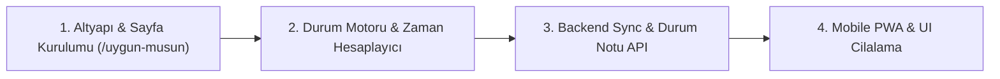

# 📱 Yeni Özellik Tasarım Planı: "Uygun Musun?" (Live Availability & Schedule Tracker)

Bu doküman, YTÜ öğrencilerinin (başlangıçta Atilla & Neva, ileride genişletilebilir çoklu profiller) gün içerisindeki canlı ders durumlarını takip etmesini, anlık boşluklarını ve ortak uygunluk saatlerini görmesini, gerektiğinde *"Ders erken bitti"* veya *"Kütüphanedeyim"* gibi durum bildirimleri girmesini sağlayan mobile-first PWA modülünün uçtan uca mimari ve geliştirme planıdır.

---

## 📌 1. Özellik Özeti & Hedefler

| Başlık | Açıklama |
| :--- | :--- |
| **Özellik Adı** | **Uygun Musun?** (`/uygun-musun`) |
| **Hedef Kitle** | Gün içinde birbirinin kampüs programını, anlık ders/boşluk durumunu takip etmek isteyen üniversite arkadaşları. |
| **Kullanıcı Modeli** | Başlangıçta 2 aktif profil (Sen ve Arkadaşın), ileride grup/çete desteği için modüler altyapı. |
| **Platform** | **Mobile-First PWA:** iPhone (Safari) ve Android için ana ekrana eklenen, tam ekran (standalone) çalışan web uygulaması. |
| **Çekirdek Değer** | "Şu an derste mi?", "Çıkmasına kaç dakika var?", "İkimiz ne zaman boşuz?", "Dersi erken bitti mi?" sorularına tek bakışta 0 saniyede net yanıt. |

---

## 🏗️ 2. Sistem Mimarisi & Teknoloji Yığını

```mermaid
flowchart TD
    subgraph Client_A ["📱 Atilla'nın Telefonu (PWA)"]
        UI_A["Canlı Durum & Zaman Çizelgesi"]
        Override_A["'Ders Erken Bitti' / 'Kütüphanedeyim'"]
        LS_A[("LocalStorage (Kişisel Cache)")]
    end

    subgraph Server ["☁️ Backend & Veri Katmanı (AWS EC2)"]
        API["FastAPI (/api/uygun-musun/...)"]
        Parser["PDF/PNG Schedule Parser"]
        Redis[("Upstash Redis (Anlık Durum & Notlar)")]
    end

    subgraph Client_B ["📱 Neva'nın Telefonu (iPhone PWA)"]
        UI_B["Neva Ekranı (Atilla'yı Canlı İzleme)"]
        Override_B["Neva Durum Güncelleme"]
        LS_B[("LocalStorage (Kişisel Cache)")]
    end

    Client_A -->|Program Yükle (PDF/PNG)| Parser
    Client_B -->|Program Yükle (PDF/PNG)| Parser
    Client_A -->|Anlık Durum Güncelle (POST)| API
    Client_B -->|Anlık Durum Güncelle (POST)| API
    API <--> Redis
    API -->|Canlı Veri Çek (Polling/SWR)| Client_A
    API -->|Canlı Veri Çek (Polling/SWR)| Client_B
```

* **Frontend:** Next.js 16 (App Router) + React 19 + Tailwind CSS v4 + Lucide Icons + PWA
* **Backend:** FastAPI (Python 3.10+)
* **Anlık Durum Eşitleme (Sync Katmanı):** Upstash Redis REST API (kısa TTL'li durum notları ve override anahtarları)
* **Yerel Önbellek (Offline-First):** `useLocalStorageState` ile her kullanıcının haftalık programı cihazında yerel tutulur; internet kesilse bile saat hesabı çalışmaya devam eder.

---

## 🧩 3. Fonksiyonel Modüller & Özellik Detayları

### 🔹 Modül 1: Profil & Ders Programı Yönetimi
* **Profil Eşleme:**
  * Kullanıcı ilk girişte kendi adını (`Atilla`) ve takip edeceği arkadaşının adını (`Neva`) seçer/tanımlar.
  * Paylaşım Kodu (Pair Code): İki tarafın birbiriyle kolayca eşleşmesi için 4-6 haneli basit bir oda/çift kodu (Örn: `ATILLA-NEVA`).
* **Hızlı Program Yükleme:**
  * USIS PDF yükleme veya tEXt metadata gömülü PNG görsel yükleme.
  * İkinci kişinin programı ister karşı tarafın yüklemesiyle buluttan gelir, ister yerel olarak doğrudan yüklenebilir.

---

### 🔹 Modül 2: Canlı Durum & Geri Sayım Motoru (Live Status Engine)
Dakika bazlı dinamik hesaplama motoru:

1. **🔴 Dersteyse:**
   * **Ders Bilgisi:** Ders Adı, Kodu, Derslik (Örn: `Matematik I - A-201`), Hoca.
   * **Kalan Süre Sayacı:** *"Dersin bitmesine 18 dakika kaldı (11:50'de çıkıyor)"*.
   * **İlerleme Çubuğu:** Ders süresinin ne kadarının tamamlandığı (% formatında görsel bar).
2. **🟢 Boşsa:**
   * **Gelecek Ders:** *"Şu an boş. Sonraki derse (Fizik I) 45 dakika var (13:00'da)"*.
   * **Ders Kalmadıysa:** *"Bugün başka dersi kalmadı! 🎉 Tamamen serbest."*
3. **🏖️ Tatil Günü:**
   * *"Bugün dersi yok."*

---

### 🔹 Modül 3: Canlı Durum Bildirimi & Manuel Override (Kullanıcının İstediği Özel Sekme)
Öğrencinin anlık durumunu arkadaşına duyurabilmesi için:

* **⚡ "Ders Erken Bitti / Çıktım" Butonu:**
  * Hoca dersi erken bitirdiğinde tek tıkla işaretlenir.
  * Programdaki ders saati dolmamış olsa bile arkadaşının ekranında durum anında **🟢 "Ders erken bitti, şu an boş"** olarak güncellenir.
* **🏷️ Hızlı Durum Rozetleri:**
  * 📚 Kütüphanedeyim
  * ☕ Orta Bahçe / Çaydayım
  * 🍽️ Yemekhanedeyim
  * 🚌 Yoldayım / Kampüse Geliyorum
  * 🎧 Odaklandım / Çalışıyorum
* **💬 Serbest Not Alanı:**
  * Örn: *"Kütüphane -1 katındayım, kahveye açığım ☕"*
* **⏱️ Zaman Aşımı (Smart Expiry):**
  * Manuel durum girilirken süre seçilebilir: *"Sonraki derse kadar"*, *"30 dakika"*, *"2 saat"*. Süre dolduğunda sistem otomatik olarak ders programı akışına döner.

---

### 🔹 Modül 4: Ortak Uygunluk & Çakışma Analizi (Hangout Matcher)
* **Anlık Uygunluk:**
  * Eğer ikiniz de o anda boşsanız: *"İkiniz de şu an uygunsunuz! 13:00'a kadar 1 saat 15 dakikanız var ☕"*
  * Biri dersteyse: *"Neva 11:50'de çıkıyor, o zaman buluşabilirsiniz."*
* **Günün Ortak Boş Pencereleri:**
  * Gün içindeki tüm çakışan boş saatler liste halinde gösterilir (Örn: `12:00 - 13:00 (Öğle Arası)`, `15:00 - 17:00`).

---

### 🔹 Modül 5: Günlük Paralel Zaman Çizelgesi (Daily Timeline View)
* Bugünün 08:00 - 18:00 saat aralığı dikey/yatay bir zaman akışında gösterilir.
* Yan yana iki şerit:
  * Sol Şerit: **Atilla**
  * Sağ Şerit: **Neva**
* Anlık kırmızı zaman çizgisi (Current Time Marker) gün boyunca akarak o anki konumu gösterir.
* Üstteki gün hapları (`Pzt`, `Sal`, `Çar`, `Per`, `Cum`) ile haftanın diğer günlerine de bakılabilir.

---

## 🎨 4. Arayüz ve Kullanıcı Deneyimi (UI/UX) Akışı

```
┌────────────────────────────────────────────────────────┐
│  🟢 UYGUN MUSUN?                     ⚙️ [Atilla & Neva]│
│────────────────────────────────────────────────────────│
│  [  Atilla (Sen)  ]          [  Neva (Arkadaşın)  ]    │
│                                                        │
│  ┌──────────────────────────────────────────────────┐  │
│  │ 👤 Neva                                🟢 MÜSAİT │  │
│  │                                                  │  │
│  │ 💬 "Kütüphane zemin kattayım, kahveye açığım ☕"  │  │
│  │ ⚡ Hoca erken bıraktı (Program: Mat I, A-201)    │  │
│  │                                                  │  │
│  │ ⏳ Sonraki Ders: Fizik I (13:00) • 42 dk var      │  │
│  │ [▓▓▓▓▓▓▓▓▓▓▓▓▓▓▓▓░░░░░░░░░] %65 Gün Tamamlandı   │  │
│  └──────────────────────────────────────────────────┘  │
│                                                        │
│  🎉 ORTAK BULUŞMA VAKTİ                                │
│  "İkiniz de 13:00'a kadar 42 dakika boyunca boşsunuz!" │
│                                                        │
│  ─── 📅 Bugünün Çizelgesi (Çarşamba) ────────────────  │
│   09:00 [ Mat I (A-201) ]   │  [ Boş / Serbest     ]   │
│   10:00 [ Mat I (A-201) ]   │  [ Kimya I (B-102)   ]   │
│   11:00 ─── ŞU AN (11:18) ──┼── ⚡ Erken Çıktı ─────  │
│   12:00 [ Ortak Boşluk ☕ ] │  [ Ortak Boşluk ☕ ]   │
│   13:00 [ Fizik Lab     ]   │  [ Fizik I           ]   │
│                                                        │
│────────────────────────────────────────────────────────│
│  [⚡ Durumunu Güncelle]             [📅 Haftalık Tablo]│
└────────────────────────────────────────────────────────┘
```

---

## 🛠️ 5. Geliştirme Adımları ve Yol Haritası



### Aşama 1: Rota ve Veri Modeli
* `frontend/src/app/uygun-musun/page.tsx` rotasının oluşturulması.
* İki profil için ders programı yükleme ve saklama (`useLocalStorageState`).

### Aşama 2: Canlı Durum ve Uygunluk Motoru
* `statusEngine.ts`: Anlık dakika, kalan ders süresi, sonraki ders, ilerleme yüzdesi ve ortak boş saat kesişim hesaplayıcıları.
* Canlı durum kartı ve dinamik geri sayım sayaçları.

### Aşama 3: Manuel Durum & Backend Senkronizasyonu
* FastAPI tarafında `POST /api/uygun-musun/status` ve `GET /api/uygun-musun/status/{pair_id}` uç noktaları.
* "Ders erken bitti", hazır rozetler ve özel durum notu bileşeni (`StatusOverrideModal.tsx`).

### Aşama 4: Mobile-First İyileştirmeler & Dağıtım
* iPhone Safari "Ana Ekrana Ekle" PWA meta etiketleri ve manifest yapılandırması.
* Dokunmatik jestler, temiz karanlık/aydınlık tema uyumu ve sunucuya dağıtım.
